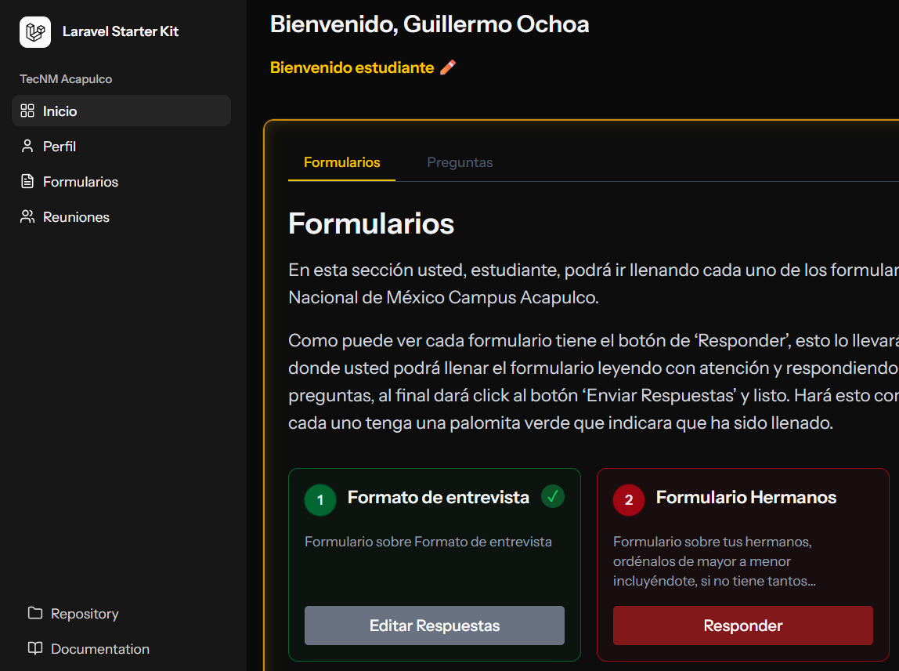

# 🧑‍🏫 Tutorías ITA

<p align="center">
  <b>Sistema web moderno para la gestión digital de tutorías académicas del Instituto Tecnológico de Acapulco.</b>
</p>

<p align="center">
  <a href="https://tutoriasita-production.up.railway.app/">
    
  </a>
</p>

---

## 🚀 Enlace del Proyecto
La aplicación se encuentra desplegada y disponible en producción en el siguiente enlace:

👉 **[Visitar Tutorías ITA](https://tutoriasita-production.up.railway.app/)**

---

## 📝 ¿Qué es “Formularios Tutorías”?

### 📚 Contexto
Hay escuelas en México que cuentan con sistemas de tutorías internas cuyo propósito es recopilar información social, familiar y académica de los estudiantes de nuevo ingreso, permitiendo así brindar un mejor acompañamiento y atención personalizada.

### ⚠️ Problema
Debido a la gran cantidad de estudiantes, este proceso suele volverse lento, poco eficiente y dependiente del uso excesivo de papel, dificultando tanto el almacenamiento como el acceso a la información.

### 💡 Solución
**“Formularios Tutorías”** se presenta como una alternativa digital que busca optimizar la conexión entre alumnos, tutores y personal administrativo mediante una plataforma moderna y respaldada por una base de datos estructurada, permitiendo completar y administrar formularios de tutorías de manera ágil y organizada.

---

## 📸 Vista Previa del Proyecto



📥 **[Descarga el PowerPoint de la guía rápida de Tutorías](public/assets/Formularios%20Tutorías%20(Guia%20rapida).pptx)**

---

## 🧩 Descripción General

**Tutorías ITA** es un sistema web desarrollado con **Laravel**, **React** e **Inertia.js**, enfocado en la administración y seguimiento de tutorías académicas dentro del Instituto Tecnológico de Acapulco.

El proyecto combina un backend robusto con una experiencia de usuario moderna tipo SPA (Single Page Application), permitiendo una navegación rápida y fluida sin recargas constantes.

### 🎯 Objetivos del Proyecto
* **Digitalización Académica:** Reducir procesos manuales y uso de papel.
* **Centralización de Información:** Organizar formularios, reuniones y usuarios desde una sola plataforma.
* **Experiencia Moderna:** Ofrecer una interfaz rápida, intuitiva y responsiva.
* **Escalabilidad:** Mantener una arquitectura limpia y preparada para futuras mejoras.

---

## ✨ Características del Proyecto

* **Gestión de Roles:** Administración de usuarios, tutores y alumnos.
* **Formularios Dinámicos:** Creación y seguimiento de preguntas y respuestas.
* **Registro de Tutorías:** Calendarización y control de reuniones entre tutores y estudiantes.
* **SPA (Single Page Application):** Navegación dinámica gracias a React + Inertia.js.
* **Interfaz Responsiva:** Adaptación completa a dispositivos móviles y escritorio.
* **Base de Datos Estructurada:** Gestión organizada de información académica.

---

## 🛠️ Tecnologías Utilizadas

| Tecnología | Descripción | Uso en el Proyecto |
| :--- | :--- | :--- |
| **Laravel** | Framework Backend de PHP | Gestión de lógica del servidor, autenticación y base de datos. |
| **React** | Biblioteca de JavaScript | Construcción de interfaces dinámicas y componentes reutilizables. |
| **Inertia.js** | Adaptador SPA | Comunicación fluida entre Laravel y React sin crear una API separada. |
| **Vite** | Build Tool / Empaquetador | Desarrollo rápido y compilación optimizada del frontend. |
| **Tailwind CSS** | Framework CSS | Diseño moderno y responsivo basado en utilidades. |
| **MySQL** | Sistema Gestor de Base de Datos | Almacenamiento y organización de la información del sistema. |
| **Railway** | Plataforma Cloud | Hosting y despliegue de la aplicación en producción. |

---

## 📋 Requisitos Previos

Antes de ejecutar el proyecto localmente asegúrate de tener instalado:

* **PHP** (>= 8.2)
* **Composer**
* **Node.js** y **npm**
* **MySQL**, **MariaDB** o **SQLite**
* **phpMyAdmin** *(opcional para administración visual de la base de datos)*
* **WampServer (WAMP)** *(recomendado en Windows para facilitar la instalación de PHP y MySQL)*

---

## 💻 Ejecución en Entorno Local

Sigue estos pasos para ejecutar el proyecto en tu máquina local:

### 🔧 Pasos de Instalación

1. **Clonar el repositorio:**

```bash
git clone https://github.com/Frangersal/TutoriasITA.git
```

2. **Entrar a la carpeta del proyecto:**

```bash
cd TutoriasITA
```

3. **Instalar dependencias de PHP:**

```bash
composer install
```

4. **Instalar dependencias de Node.js:**

```bash
npm install
```

5. **Configurar el entorno:**

Duplica el archivo `.env.example` y renómbralo a `.env`.

Ejemplo de configuración:

```env
DB_CONNECTION=mysql
DB_HOST=127.0.0.1
DB_PORT=3306
DB_DATABASE=tutoriasita
DB_USERNAME=root
DB_PASSWORD=
```

6. **Generar la clave de Laravel:**

```bash
php artisan key:generate
```

7. **Ejecutar migraciones y seeders:**

```bash
php artisan migrate --seed
```

8. **Iniciar los servidores de desarrollo:**

Frontend (React + Vite):

```bash
npm run dev
```

Backend (Laravel):

```bash
php artisan serve
```

9. **Abrir la aplicación:**

Visita en tu navegador:

```txt
http://localhost:8000
```

---

## 📦 Despliegue y Construcción

Para generar los archivos optimizados de producción:

```bash
npm run build
```

---

## 🌱 Estructura General del Proyecto

```txt
TutoriasITA/
│
├── app/
├── database/
├── public/
├── resources/
│   ├── js/
│   ├── css/
│   └── views/
│
├── routes/
├── storage/
├── package.json
├── composer.json
├── vite.config.js
└── README.md
```

---

<p align="center">
  Desarrollado con ❤️ por <a href="https://github.com/Frangersal">Frangersal</a>
</p>
